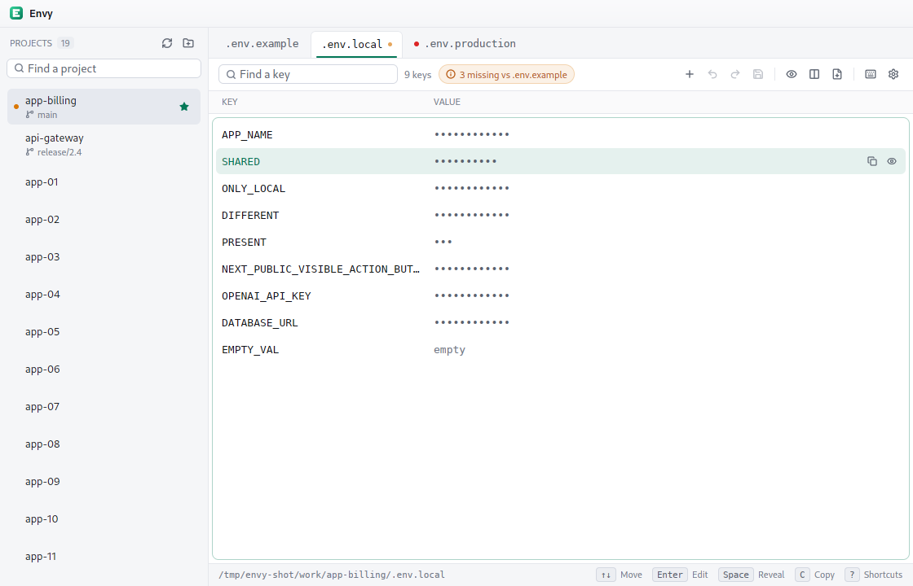
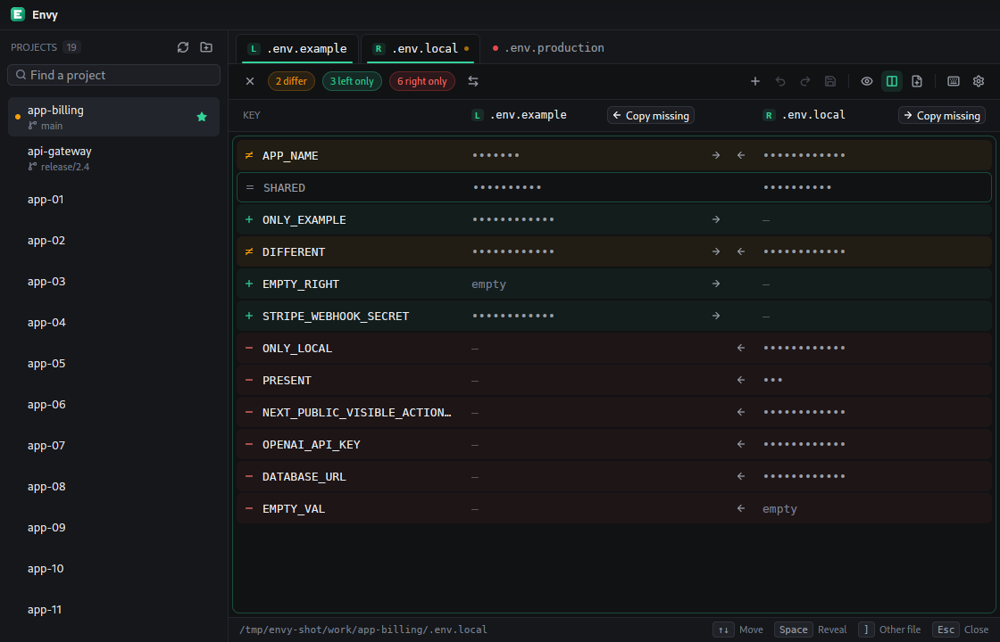
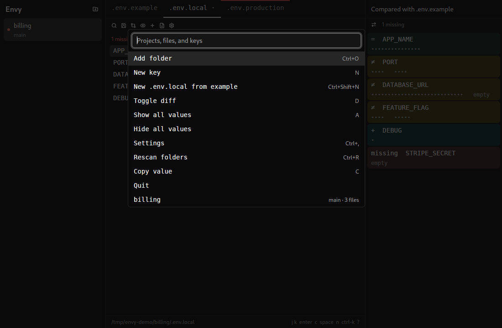
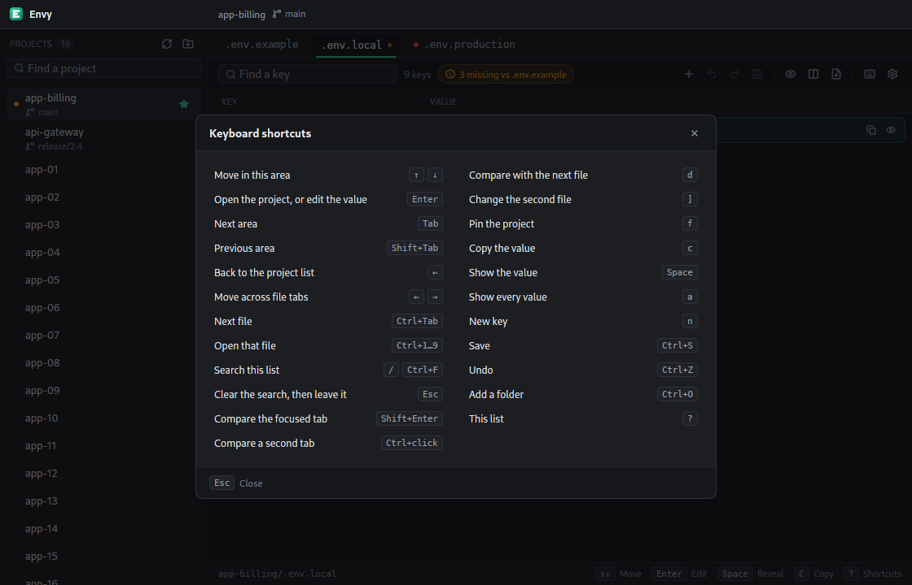

# Envy

<picture>
  <source media="(prefers-color-scheme: dark)" srcset="assets/icon/envy-readme-header-dark.png">
  
</picture>

Envy is a fast, keyboard-first editor for `.env` files. It edits the files where they already live, and only inside folders you add. Files are grouped by the git repository they belong to.

The window is [GPUI](https://github.com/zed-industries/zed) through [gpui-kit](https://github.com/longbridge/gpui-component) 0.10. Parsing, discovery, diff, and file IO live in `envy-core`, so later tools can share one model of a `.env` file.


## Features

- Add folders yourself. Envy lists `.env`, `.env.*`, and `*.env` files as it finds them, skips dependency directories, and groups the files by git repo (remote name, otherwise the folder) and shows the branch. The list is remembered, so the next launch shows it at once and then refreshes.
- Lossless editing. Comments, blank lines, quoting, `export`, and multiline values stay as they were. Only the keys you change are rewritten.
- Edit in the row. Enter starts an edit, Esc cancels, Enter or Tab commits. New keys, rename, and paste all stay in the table.
- Undo and redo (`Ctrl+Z`, `Ctrl+Y` or `Ctrl+Shift+Z`) apply to the open buffer. `Ctrl+S` writes the file. Switching files or closing the window also writes unsaved edits.
- Atomic save. The new text is written to a sibling `*.envy-tmp` file, synced, then renamed over the original. A crash before the rename leaves the `.env` intact. The sibling is deleted if the save fails, and Envy never opens it as an env file.
- Masked values (one dot per character), per-key reveal, and show-all. Copy clears the clipboard after 30 seconds unless you turn that off.
- Diff against another file in the project. Rows are colored for equal, different, only in this file, and missing. One button copies the missing keys into the file you are editing.
- Paste a block of `KEY=value` lines (the block Vercel's env UI copies). Envy shows a preview; Enter applies it.
- New `.env.local` from `.env.example`: comments and safe defaults stay, secret values are cleared.
- Search with `Ctrl+K` over project, file, and key names. Values are not searchable and are not stored in config or logs.
- Light and dark, following the system, with an override. Production files (a `prod` or `production` segment in the name) get a thin red tab accent.
- A single instance. `envy://` links and a second launch are handed to the window that is already open. `Ctrl+Alt+E` raises it (change the chord in settings). Closing the window quits. There is no tray icon.

## Keyboard

Press `?` for the same list inside the window.

| Key | Action |
| --- | --- |
| `j` `k` or `↑` `↓` | Move |
| `h` `l` or `←` `→` | Previous / next file |
| `Enter` | Edit the value in the row |
| `Tab` | Commit the edit |
| `Esc` | Cancel the edit, or close a panel |
| `c` | Copy the value |
| `Space` | Show or hide the value |
| `a` | Show or hide every value |
| `n` | New key |
| `F2` | Rename the key |
| `x` `Delete` `Backspace` | Remove the key (`Ctrl+Z` brings it back) |
| `Ctrl+Z` | Undo |
| `Ctrl+Y` or `Ctrl+Shift+Z` | Redo |
| `Ctrl+S` | Save |
| `Ctrl+K` | Search projects, files, and key names |
| `Ctrl+V` | Paste `KEY=value` lines |
| `d` | Diff |
| `]` | Next file to compare |
| `Ctrl+Shift+N` | New `.env.local` from the example |
| `Ctrl+O` | Add a folder |
| `Ctrl+,` | Settings |
| `Ctrl+R` | Rescan folders |
| `?` | Shortcut list |

## Screenshots

Files, dark. The selected row has copy and reveal icons.


The same file in light, with the diff open. Green is equal, amber differs, blue is only in this file, red is missing here.





Editing the value in the row.


Search.



First launch, before any folder is added.


Shortcut list (`?`).



## Build

Windows is the primary target. Install the [MSVC toolchain](https://rustup.rs/) (`rustup default stable-x86_64-pc-windows-msvc`) and [CMake](https://cmake.org/). GPUI links native code, so `cl.exe` and `cmake` need to be on `PATH`.

```powershell
git clone https://github.com/GlennSvanberg/Envy.git
cd Envy
cargo run -p envy --release
```

The release binary is `target\release\envy.exe`. GitHub Actions builds it on `windows-latest` and uploads it as `envy-windows`.

On first launch Envy registers the `envy://` URL scheme for the current user (`HKCU\Software\Classes\envy`). Config is `%APPDATA%\envy\config.toml` (on Linux, `$XDG_CONFIG_HOME/envy` or `~/.config/envy`). It stores folders, theme, the global hotkey, and optional project names. It never stores environment values.

The same workspace builds on Linux with `libfontconfig1-dev`, `libwayland-dev`, `libxkbcommon-dev`, `libx11-dev`, `libx11-xcb-dev`, `libxcb1-dev`, `libssl-dev`, `libzstd-dev`, `cmake`, and `pkg-config`. The global hotkey uses X11 there and does not register under Wayland. Add folder uses the system folder dialog. If that dialog cannot open, type the path instead.

## Deeplinks

```
envy://project/<repo-name>
envy://project/<repo-name>/<file>
envy://project/<repo-name>/<file>?key=KEY
```

`<repo-name>` is the name in the sidebar. `<file>` is the filename, such as `.env.local`. Names are percent-encoded when they contain spaces or `?`.

## Tests

```powershell
cargo test --workspace --locked
```

The core tests cover a byte-for-byte parse round-trip, editing one key without rewriting the rest, Vercel-style paste, the diff, creating a file from an example, and an atomic save that leaves no temp file behind.
