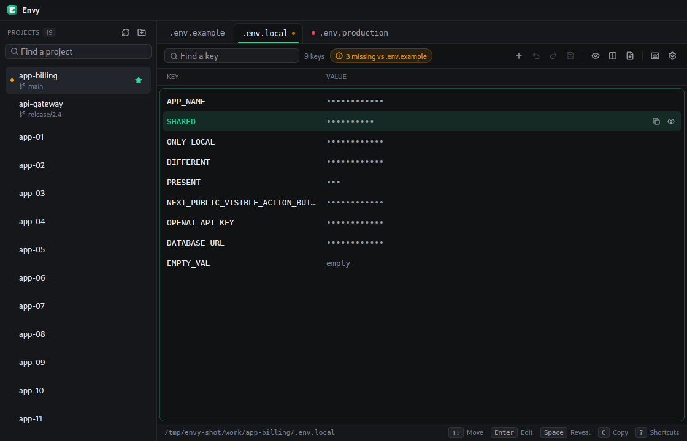
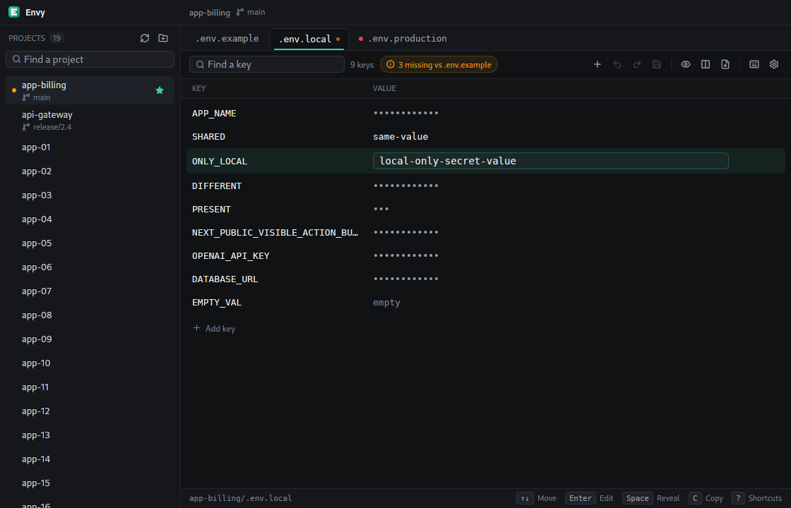
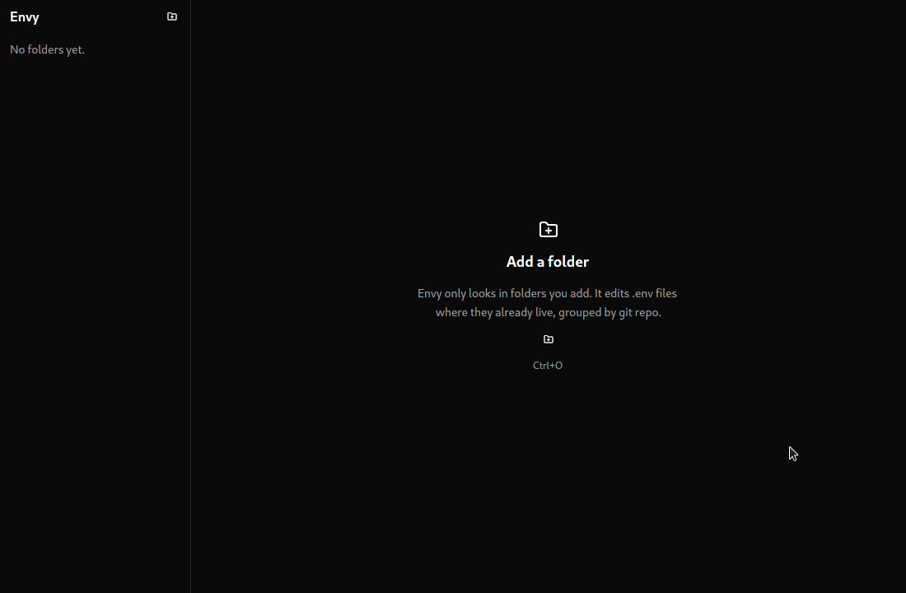

# Envy

<picture>
  <source media="(prefers-color-scheme: dark)" srcset="assets/icon/envy-readme-header-dark.png">
  
</picture>

Envy edits `.env` files where they already live, inside folders you add. Files are grouped by git repo.

The window is [GPUI](https://github.com/zed-industries/zed) through [gpui-kit](https://github.com/longbridge/gpui-component) 0.10. Parsing, discovery, and file IO live in `envy-core`.



## Features

- Add folders. Envy lists `.env`, `.env.*`, and `*.env` as it finds them, skips dependency directories, and groups files by git repo. The list is saved, so the next launch shows it and then refreshes.
- Comments, blank lines, quoting, `export`, and multiline values stay as they were. Only the keys you change are rewritten.
- Enter edits the value in the row. Esc cancels. Enter or Tab commits.
- Undo and redo (`Ctrl+Z`, `Ctrl+Y` or `Ctrl+Shift+Z`). `Ctrl+S` writes the file. Switching files or closing the window also writes unsaved edits.
- Save writes a sibling file, then replaces the original. A crash before the replace leaves the `.env` intact.
- Values are masked. Reveal one key, or all of them. Copy clears the clipboard after 30 seconds unless you turn that off.
- Ctrl+click or Shift+click two file tabs to compare them. Keys line up in two columns. Each row can copy a value either way, and each side can copy every missing key. A plain click returns to the file.
- Paste a block of `KEY=value` lines. Envy shows a preview; Enter applies it.
- New `.env.local` from `.env.example`. Comments and safe defaults stay. Secret values are cleared.
- Find a project from the sidebar field, and a key from the field above the list. `/` or `Ctrl+F` focuses the field for the area you are in. Values are not searchable and are not stored.
- Light and dark, following the system, with an override. The accent is the logo green. A production file name gets a red dot.
- One window. `envy://` links and a second launch go to the window that is already open. `Ctrl+Alt+E` raises it. Closing the window quits.

## Keyboard

Press `?` for the same list inside the window.

| Key | Action |
| --- | --- |
| `↑` `↓` | Move. Down from a search field enters its list |
| `Enter` | Open the project, open the tab, or edit the value |
| `Tab` `Shift+Tab` | Next / previous area: projects, file tabs, keys |
| `←` | Back to the project list. In the file tabs, the previous tab |
| `→` | Next area, or the next tab |
| `Ctrl+Tab` | Next file. `Ctrl+Shift+Tab` previous. `Ctrl+1` through `Ctrl+9` open that file |
| `/` or `Ctrl+F` | Search the area you are in. `Esc` clears it, then leaves the field |
| `Shift+Enter` or Ctrl+click | Compare two file tabs. A plain click closes the comparison |
| `d` | Compare the open file with the example, or the next file. `]` changes the second file |
| `f` | Pin or unpin the selected project |
| `c` | Copy the value |
| `Space` | Show or hide the value |
| `a` | Show or hide every value |
| `n` | New key |
| `F2` | Rename the key |
| `x` `Delete` `Backspace` | Remove the key |
| `Ctrl+Z` | Undo |
| `Ctrl+Y` or `Ctrl+Shift+Z` | Redo |
| `Ctrl+S` | Save |
| `Ctrl+V` | Paste `KEY=value` lines |
| `Ctrl+Shift+N` | New `.env.local` from the example |
| `Ctrl+O` | Add a folder |
| `Ctrl+,` | Settings |
| `Ctrl+R` | Rescan folders |
| `?` | Shortcut list |

## Screenshots

Files, dark. The selected row has copy and reveal icons.


The same file in light, with a comparison open. Green is equal, amber differs, red is only on the right.


Editing the value in the row.



First launch, before any folder is added.



Shortcut list (`?`).


## Build

Windows is the primary target. Install the [MSVC toolchain](https://rustup.rs/) (`rustup default stable-x86_64-pc-windows-msvc`) and [CMake](https://cmake.org/). GPUI links native code, so `cl.exe` and `cmake` need to be on `PATH`.

```powershell
git clone https://github.com/GlennSvanberg/Envy.git
cd Envy
cargo run -p envy --release
```

The release binary is `target\release\envy.exe`. GitHub Actions builds it on `windows-latest` and uploads it as `envy-windows`.

On first launch Envy registers the `envy://` URL scheme for the current user (`HKCU\Software\Classes\envy`). Config is `%APPDATA%\envy\config.toml` (on Linux, `$XDG_CONFIG_HOME/envy` or `~/.config/envy`). It stores folders, theme, the global hotkey, and optional project names. It never stores environment values.

The same workspace builds on Linux with `libfontconfig1-dev`, `libwayland-dev`, `libxkbcommon-dev`, `libx11-dev`, `libx11-xcb-dev`, `libxcb1-dev`, `libssl-dev`, `libzstd-dev`, `cmake`, and `pkg-config`. The global hotkey uses X11 there and does not register under Wayland. Add folder uses the system folder dialog. If that dialog cannot open, type the path instead.

## Deeplinks

```
envy://project/<repo-name>
envy://project/<repo-name>/<file>
envy://project/<repo-name>/<file>?key=KEY
```

`<repo-name>` is the name in the sidebar. `<file>` is the filename, such as `.env.local`. Names are percent-encoded when they contain spaces or `?`.

## Tests

```powershell
cargo test --workspace --locked
```

The core tests cover a byte-for-byte parse round-trip, editing one key without rewriting the rest, Vercel-style paste, the diff, creating a file from an example, and an atomic save that leaves no temp file behind.
